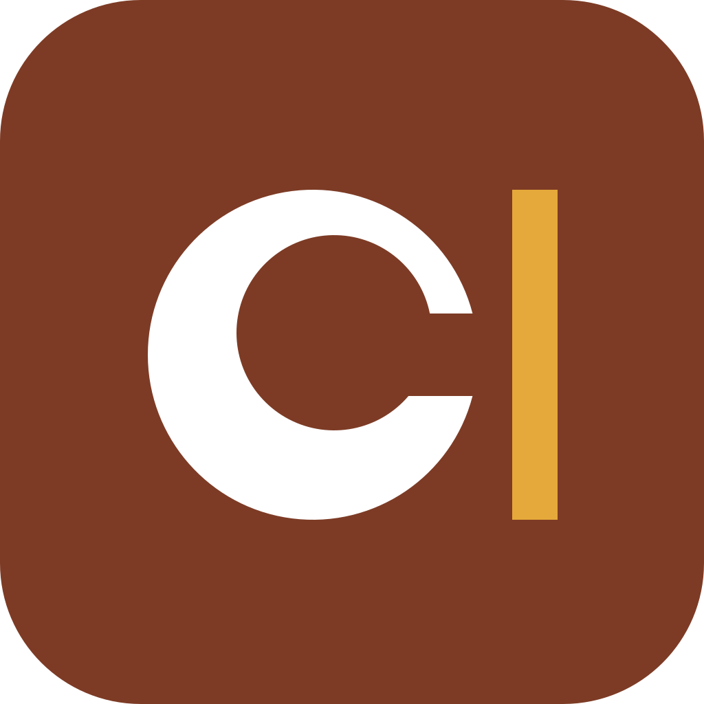

<p align="center">
  
</p>

# Carrel

Carrel is a free operating system that turns an old laptop into a dedicated,
distraction-free writing device, in the spirit of a Freewrite.

Open the lid and the cursor is on screen, at the last word you wrote. There is
no desktop, no browser, no notifications and no other app. Text is saved all
the time. One key sends your drafts to Nostos Cloud or to your own server, then
the network goes off again.

Project homepage: <https://carrel.nostos.page>. Carrel was formerly called Stylos.

Carrel works best with [Nostos](https://nostos.page): drafts appear in the
Nostos Writing Studio, and your highlights, notes and passages are searchable
on the device, offline, and insert as live citations.

## Status

Pre-alpha. Built mostly by AI agents against the specs in [`spec/`](spec/).

## Repository

| Path | What |
|---|---|
| `spec/` | Product rules, architecture, protocol, UI and phase plan. Read first. |
| `dev/` | Docker dev container (Debian 13 toolchain: Rust, GTK4, mkosi, QEMU). |
| `image/` | mkosi configuration for the bootable image and A/B updates. |
| `shell/` | `carrel-shell`: the Rust + GTK4 app (editor, files, settings, quotes, sync UI). |
| `carreld/` | `carreld`: Rust system daemon (history, sync, radio, updates). |
| `protocol/` | `carrel-protocol`: shared Rust crate with sync protocol types. |
| `server/` | `carrel-server`: self-hosted sync server (single binary / Docker). |
| `tests/` | QEMU boot tests and end-to-end sync tests. |

## Install Carrel

You do not need Docker, Linux or a build environment to use Carrel.

1. Download `carrel-<version>.img.xz` from the release page. Check it with
   the `.sha256` file; the `.asc` file is the release signature (see
   [`image/README.md`](image/README.md#verify-a-download)).
2. Flash the file to a USB stick (8 GB or more) with one of:
   - [Fedora Media Writer](https://fedoraproject.org/workstation/download):
     choose "Select .iso file…", pick the `.img.xz` file (it unpacks it).
   - [balenaEtcher](https://etcher.balena.io/): "Flash from file".
   - [Rufus](https://rufus.ie/) on Windows: select the file and choose
     **DD Image mode** when asked.
   - `xz -dc carrel-<version>.img.xz | sudo dd of=/dev/sdX bs=4M status=progress conv=fsync`
     (check that `/dev/sdX` is the stick).
3. Boot the laptop from the stick. Choose **Try Carrel** (nothing on the
   laptop changes) or **Install to this computer** (type `ERASE`; the whole
   internal disk is replaced).

Secure Boot stays on. Carrel boots through Debian's Microsoft-signed `shim`,
so you do not change any firmware setting. After an install, Carrel is the
first entry in the laptop's boot menu.

## Build the image (developers)

Docker is only the **build environment**: it holds the toolchain (Rust, GTK4,
mkosi, QEMU). It is not part of Carrel and a user never runs it. Everything
below runs in the dev container; the host needs only Docker.

```sh
dev/run.sh --root make image      # build out/image/carrel.img.raw
dev/run.sh --root make release    # signed update payloads + out/dist/carrel-<version>.img.xz
dev/run.sh --root make test-boot  # boot UEFI, Secure Boot and BIOS in QEMU
```

`make release` needs the release keys in `~/.config/carrel/keys` (`make
keys` creates development keys). See `image/README.md` for the image layout,
Secure Boot chain and release files, and `tests/boot/run.py` for the
assertions.

## License

GPL-3.0-or-later for the OS, shell and daemon. MIT for `protocol/` and
`server/`, so that other services (such as Nostos) can implement the protocol.
