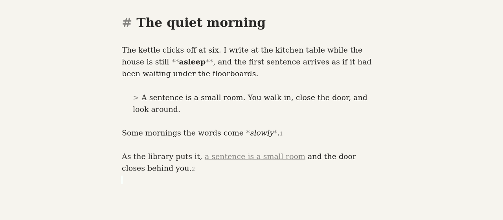
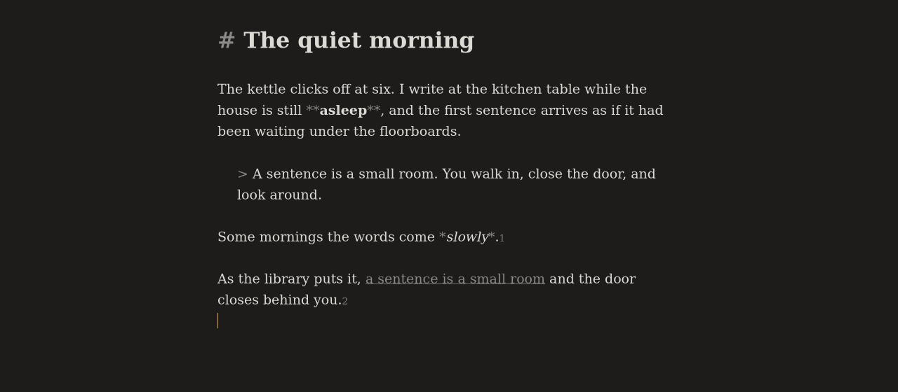
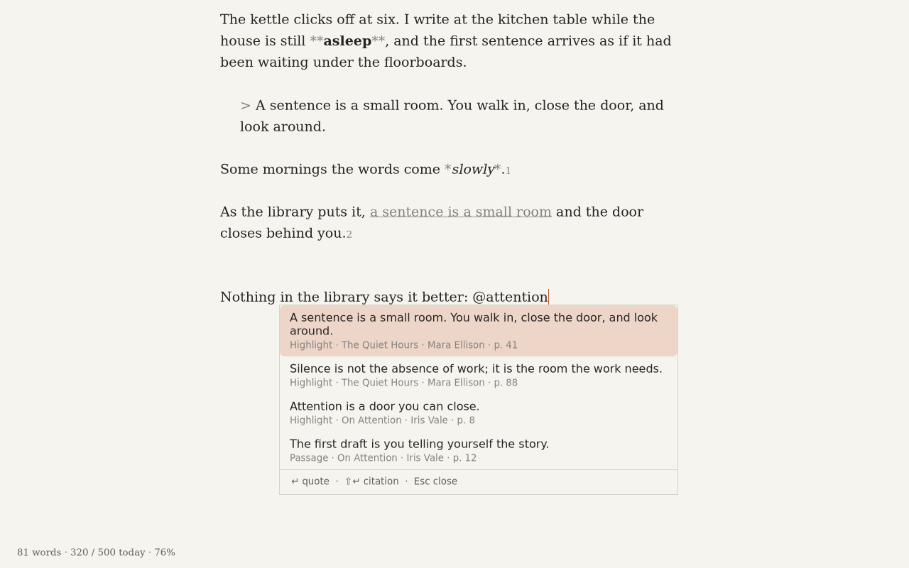
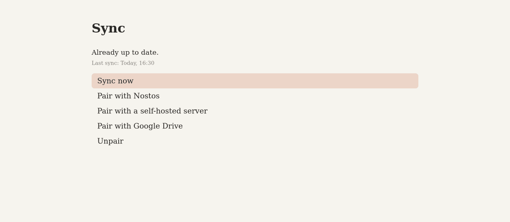

<p align="center">
  
</p>

<h1 align="center">Carrel</h1>

<p align="center">
A free operating system that turns an old laptop into a quiet, distraction-free writing machine.
</p>

<p align="center">
  
</p>

<table>
  <tr>
    <td></td>
    <td></td>
    <td></td>
  </tr>
</table>

Open the lid and the cursor is on screen, at the last word you wrote. There is
no desktop, no browser and no notifications. Carrel runs one app, and that app
is a Markdown editor.

## Why Carrel

- **One app owns the screen.** No desktop, launcher, browser or app switching.
- **Offline until you sync.** Wi-Fi is off at all other times. Nothing runs in
  the background on the network.
- **Nothing is lost.** No keystroke older than one second is lost on a power
  cut or crash, and every past version of a file can be restored.
- **Your files stay yours.** Plain `.md` files in normal folders. Export to a
  USB stick (Markdown, text, Word, OpenDocument, PDF, HTML, EPUB) with no
  account and no network.
- **Recovery is one key.** A failed update boots the previous system. A key at
  boot opens a recovery menu.
- **Secure Boot can stay on.** Carrel boots through Debian's signed `shim`.
- **No AI writes for you.** The device never generates text.

## Get Carrel

Download the image from [carrel.nostos.page](https://carrel.nostos.page) or from
[GitHub Releases](https://github.com/Christian-Gennari/carrel/releases).

1. Download `carrel-<version>.img.xz`. Check it with the `.sha256` file; the
   `.asc` file is the release signature
   ([how to verify](image/README.md#verify-a-download)).
2. Flash it to a USB stick (8 GB or more) with
   [Fedora Media Writer](https://fedoraproject.org/workstation/download),
   [balenaEtcher](https://etcher.balena.io/), [Rufus](https://rufus.ie/) in
   **DD Image mode**, or
   `xz -dc carrel-<version>.img.xz | sudo dd of=/dev/sdX bs=4M status=progress conv=fsync`.
3. Boot the laptop from the stick.
4. Choose **Try Carrel** (nothing on the laptop changes) or **Install to this
   computer** (type `ERASE`; the whole internal disk is replaced).

**Hardware.** Any 64-bit x86 laptop with 4 GB of RAM, 16 GB of storage and Intel
or AMD graphics. Tested and supported first: ThinkPad X230, T430, X250, T450,
T480 and T14 Gen 1, and Dell Latitude E7450. Other laptops with Intel graphics
and Intel Wi-Fi should work. NVIDIA Optimus, Broadcom Wi-Fi and Chromebooks are
not supported. Details: [spec/04-hardware.md](spec/04-hardware.md).

## Works best with Nostos

[Nostos](https://nostos.page) is a library for the books you read. With Carrel,
your drafts appear in the Nostos Writing Studio, and your highlights, notes and
passages are searchable on the device, offline, and insert as live citations.
Type `@` at the start of a word (or press Ctrl+') and the palette opens at the
cursor, the same way it does in the Writing Studio.

Carrel works fully without any account. When you press the sync key it can
send your drafts to Nostos Cloud, to your own server
([`carrel-server`](server/README.md)) or to your own Google Drive folder. Then
the network goes off again. The protocol is in
[spec/02-sync-protocol.md](spec/02-sync-protocol.md).

## Status

Carrel 0.1.0 is a preview release. The whole system is tested automatically
in QEMU: boot on UEFI, Secure Boot and BIOS, install to a blank disk, power
cut, update with rollback, recovery menu, and the signed release image.
Testing on real laptops starts with this release, so expect rough edges and
keep a copy of anything important. Installed devices check
[GitHub Releases](https://github.com/Christian-Gennari/carrel/releases) for
signed updates.

## Build from source

Docker is only the build environment: it holds the toolchain (Rust, GTK4,
mkosi, QEMU). It is not part of Carrel and a user never runs it.

```sh
dev/run.sh make keys              # development release keys, in ~/.config/carrel/keys
dev/run.sh --root make image      # build out/image/carrel.img.raw
dev/run.sh --root make release    # signed update payloads + out/dist/carrel-<version>.img.xz
dev/run.sh --root make test-boot  # boot UEFI, Secure Boot and BIOS in QEMU
make distclean                    # delete all build outputs (out/, target/, mkosi cache)
```

The image layout, Secure Boot chain and release files are described in
[image/README.md](image/README.md). To contribute, read [AGENTS.md](AGENTS.md)
and the product rules in [spec/00-rules.md](spec/00-rules.md).

## Project layout

| Path | What |
|---|---|
| `shell/` | `carrel-shell`: the Rust + GTK4 app (editor, files, settings, quotes, sync). |
| `carreld/` | `carreld`: the system daemon (history, sync, radio, updates). |
| `protocol/` | `carrel-protocol`: sync protocol types shared by the device and the server. |
| `server/` | `carrel-server`: the self-hosted sync server (single binary or Docker). |
| `export/` | `carrel-export`: Markdown to Word, OpenDocument, PDF, HTML and EPUB. |
| `image/` | mkosi configuration for the bootable image and A/B updates. |
| `brand/` | The Carrel mark. |
| `spec/` | Product rules, architecture, protocol, UI and hardware. |
| `tests/` | QEMU boot tests. |
| `dev/` | The Docker build environment and the screenshot script. |

## License

GPL-3.0-or-later for the OS, shell, daemon and export crate
([LICENSE](LICENSE)). MIT for `protocol/` and `server/`
([protocol/LICENSE](protocol/LICENSE), [server/LICENSE](server/LICENSE)), so
that other services can implement the protocol.

Carrel was formerly called Stylos.
